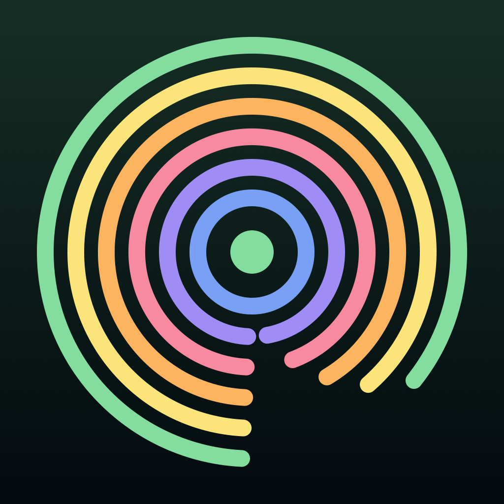

# Grow a Song

Your time outside becomes music. Every minute outdoors in daylight adds a layer to
today's track: drone, pads, bass, drums, melody, and finally a field recording of
where you are. A local Gemma 3 1B model composes each song on your iPhone. Nothing
leaves the device.

Built for the [DEV Hacktoberfest Open-Source AI Challenge, Week 1: Touch Grass](https://dev.to/challenges/hacktoberfest-week1-2026-10-05).

<p align="center"></p>

## How it works

- **Gemma composes, Swift plays.** Gemma 3 1B (QAT 4-bit) runs on device through
  [MLX Swift LM](https://github.com/ml-explore/mlx-swift-lm). It picks key, scale, tempo,
  chord progression, instruments, a title and a liner note, returned as JSON constrained
  by a JSON Schema. A deterministic sequencer and a small synth written in Swift turn that
  into audio.
- **Outside detection without a light sensor.** A minute counts when the sun is above
  civil twilight (NOAA solar equations, computed locally) and you are moving on foot, or
  the GPS fix suggests open sky away from home. With an Apple Watch, measured time in
  daylight from HealthKit is used instead.
- **Layers unlock** at 0, 8, 25, 42, 67 and 100 percent of your daily target.
- **Works offline** after a one-time 0.8 GB model download.

## Layout

```
Packages/GrowCore    pure Swift engine: solar math, outside classifier, layer schedule,
                     SongSpec contract, sequencer, realtime synth, WAV I/O, render CLI
Shared/Composer      GemmaComposer (MLX, schema-guided decoding, fallbacks)
App/                 iOS app (SwiftUI, AVAudioEngine, CoreLocation, CoreMotion, HealthKit)
Watch/               optional watchOS companion (rings, haptics, workout session)
Tools/ComposerEval   macOS CLI that runs the real composer for quick evals
scripts/             icon and demo video tooling
docs/                plan, run checklist, demo script, post draft
```

## Build

Requirements: Xcode 26+, an iPhone with iOS 17+ (MLX needs a real GPU; the simulator
runs the UI with built-in songs only), [XcodeGen](https://github.com/yonaskolb/XcodeGen),
and the Metal toolchain (`xcodebuild -downloadComponent MetalToolchain`).

1. Set your own `DEVELOPMENT_TEAM` in `project.yml`.
2. Use the harness:

| Command | What it does |
|---|---|
| `make test` | GrowCore unit tests |
| `make render` | Renders each layer stage to `out/*.wav` with loudness numbers |
| `make eval N=6` | Runs Gemma on the Mac: JSON validity, fallback rate, latency |
| `make sim` | Builds the iOS app for the simulator |
| `make device` | Builds, installs and launches on the first connected iPhone |

## Privacy

Location, motion, health data and sound clips stay on the phone. The app makes no
network calls except the one-time model download from Hugging Face.

## License

Code: MIT, see [LICENSE](LICENSE). Gemma weights are downloaded at runtime and are
subject to the [Gemma Terms of Use](https://ai.google.dev/gemma/terms).
